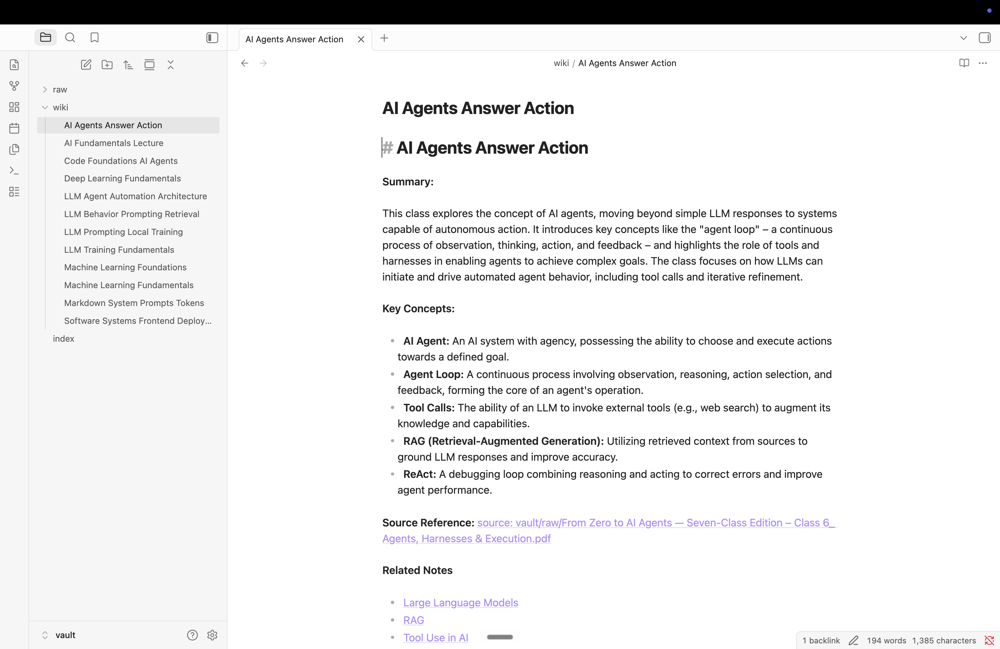
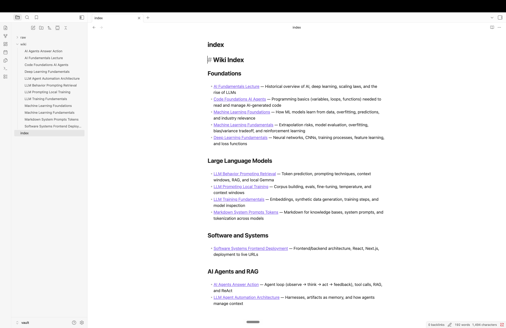
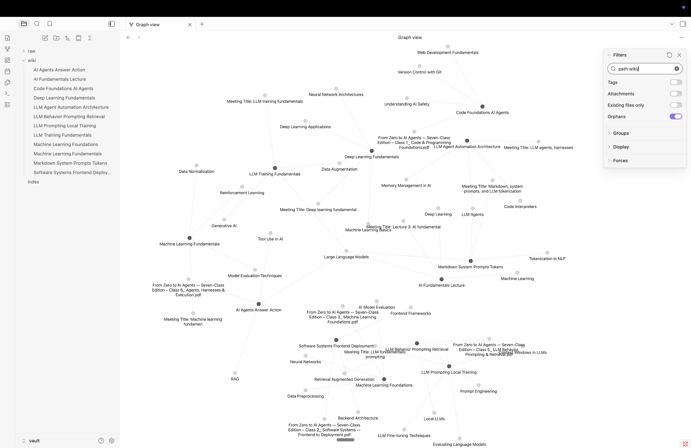
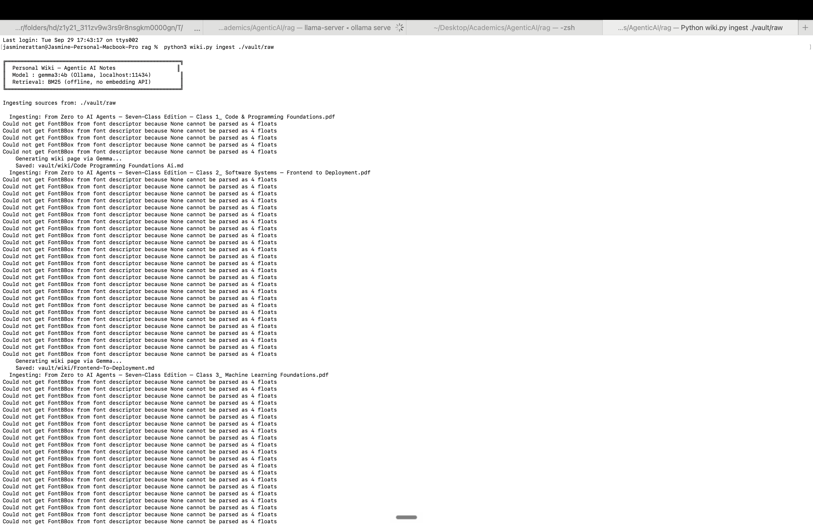
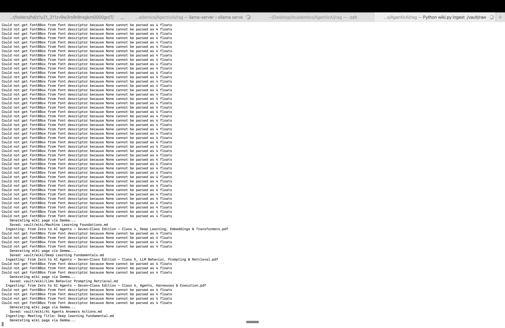
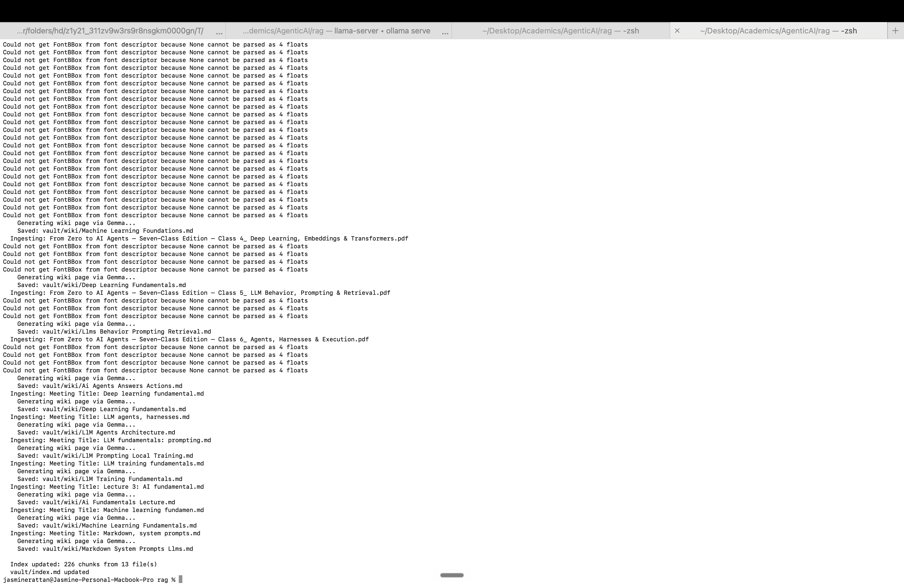
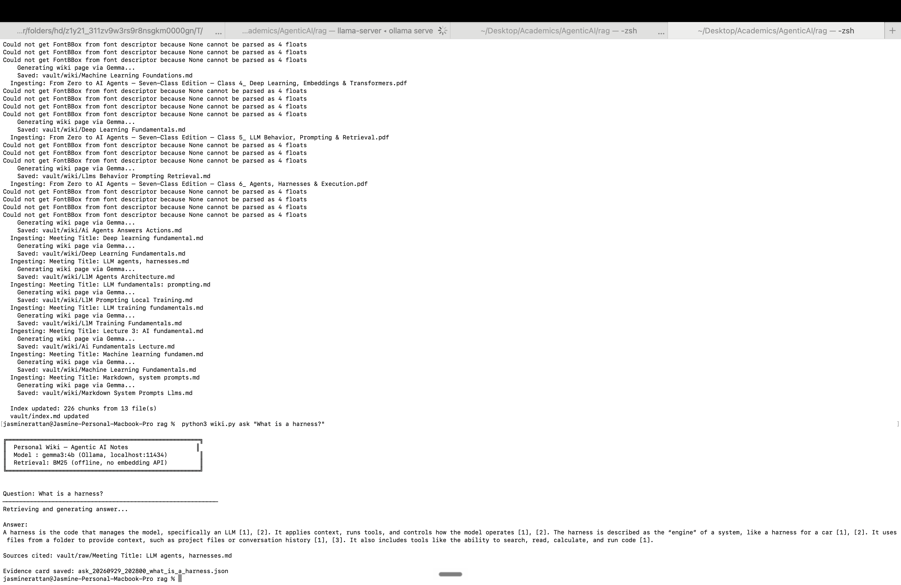
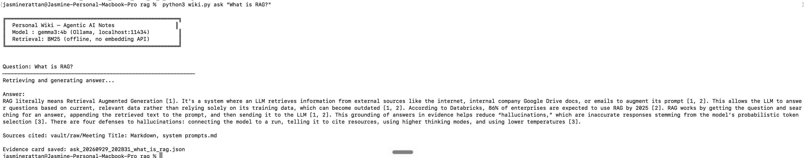
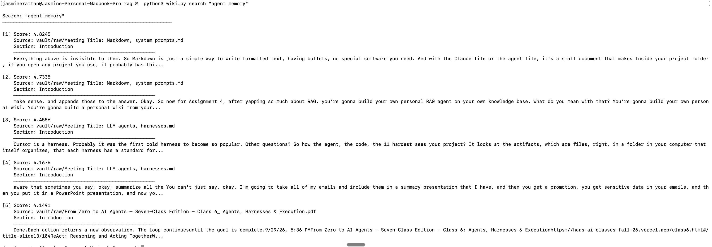
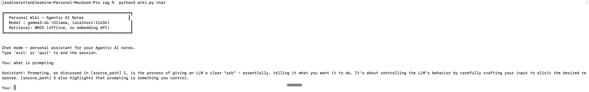

# Personal Wiki — Agentic AI Notes (Assignment 4)

A fully offline CLI + RAG harness that lets you query your own Agentic AI class notes using a local Gemma model. No cloud API calls required after setup.

---

## 1. Purpose & Sources

**Purpose:** Turn raw class notes into a searchable, AI-queryable personal wiki with three distinct interaction modes (chat, ask, search) and a BM25 retrieval engine.

**Sources:** 13 source files in `vault/raw/` — 6 class PDFs + 7 meeting transcript markdowns. The ingest pipeline produces 226 chunks across those 13 files, generates 12 wiki pages in `vault/wiki/`, and builds a BM25 index at `data/chunks.json`.

---

## 2. Device & Model

| Component | Details |
|-----------|---------|
| Device | Apple M4 MacBook Pro, 16GB unified memory |
| Model | `gemma3:4b` (Q4_0 quantization, ~4.5GB VRAM) |
| Ollama version | 0.34.4 |
| Runtime | Ollama (localhost:11434) |
| Retrieval | BM25 — `rank_bm25` (pure Python, fully offline) |
| Python | 3.11+ |

### Measured Performance

| Metric | Value |
|--------|-------|
| Peak Ollama memory (ask mode) | 1.54 GB (`llama-server` process, gemma3:4b Q4_0) |
| ask-mode response time | 3.987 seconds (`time python3 wiki.py ask "What is a harness?"`) |

> To measure: open Activity Monitor → Memory tab, run `python wiki.py ask "What is a harness?"`, note peak Physical Memory for the `ollama` process and the elapsed wall-clock time.

---

## 3. Setup

```bash
# 1. Install Ollama (one-time, requires internet)
brew install ollama
ollama serve          # start in background terminal
ollama pull gemma3:4b

# 2. Python dependencies
pip install -r requirements.txt

# 3. Place your source files
cp your_notes.md vault/raw/

# 4. Ingest (builds BM25 index + generates wiki pages)
python wiki.py ingest ./vault/raw
```

---

## 4. Usage

```bash
python wiki.py ingest ./vault/raw          # ingest all sources
python wiki.py search "agent memory"       # BM25 search, no model
python wiki.py ask "What is RAG?"          # retrieve + Gemma + citations
python wiki.py chat                        # interactive assistant session
python wiki.py --help                      # all commands
```

---

## 5. Architecture

```
CLI (wiki.py / argparse)
    │
    ├── ingest  ──► harness/ingest.py      reads raw files, chunks, calls Gemma,
    │                                       saves wiki pages + updates BM25 index
    │
    ├── search  ──► harness/search_mode.py loads BM25, returns raw passages (no model)
    │
    ├── ask     ──► harness/ask_mode.py    retrieves top-3 passages, builds prompt,
    │                                       calls Gemma, extracts citations, saves
    │                                       evidence card to evidence/
    │
    └── chat    ──► harness/chat_mode.py   loads persona, manages 10-turn history,
                                            selective retrieval on factual queries,
                                            calls Gemma, saves chat_history.json
```

**Components:**
- **Model layer** (`harness/model.py`): thin wrapper around Ollama's HTTP API
- **Retrieval tool** (`harness/retrieval.py`): BM25Okapi index, built from `data/chunks.json`
- **RAG workflow** (ask mode): retrieve → inject passages into prompt → generate → extract citations
- **CLI** (`wiki.py`): argparse subcommands, error handling, startup info
- **Harness** (mode files): each mode has its own instructions, history policy, and retrieval policy

---

## 6. Design Choices

| Decision | Rationale |
|----------|-----------|
| BM25 retrieval | Fully offline, no embedding API, deterministic, fast on small corpora |
| ~400-word chunks with 50-word overlap | Balances context richness vs. retrieval precision; overlap prevents boundary cutoffs |
| Top-3 passages | Enough context for synthesis without overflowing Gemma's effective context |
| Separate persona vs. research instructions | Chat needs personality + suggestions; ask mode needs strict citation discipline |
| No shared history between modes | ask mode is stateless by design — grading requires reproducible evidence cards |

### How Much Text Is Passed to Gemma

- **Ingest (wiki generation):** Each source file is read and the first 6,000 characters of text (`text[:6000]`) are passed to Gemma as context to generate a wiki page. This keeps the prompt within Gemma's context window while covering the most important content.
- **Ask mode:** The top-3 BM25 chunks (each ~400 words) are concatenated and injected into the prompt. These chunks are retrieved from `data/chunks.json` — no 6,000-character cap applies here since chunks are already bounded by the chunking step.
- **All 226 chunks** are indexed in BM25 and used purely for retrieval ranking; Gemma only sees the top-3 at inference time.

### How Re-Ingestion Avoids Duplicates

When `ingest` is run on a file that already exists in the index, the harness removes all existing chunks whose `source_path` matches that file before adding the new chunks. This means re-ingesting a file replaces its old chunks rather than doubling them. New files are simply appended. The BM25 index is then rebuilt from the updated `data/chunks.json`.

---

## 7. Mode Behavior Summary

| Mode | Instructions | History | Retrieval | Model | Output |
|------|-------------|---------|-----------|-------|--------|
| chat | persona.md | yes (10 turns) | selective (factual keywords) | yes | conversational + optional citations |
| ask | wiki-instructions.md | NO | always (top 3) | yes | neutral answer + required citations |
| search | none | NO | always | NO | raw passages + source paths |
| ingest | ingest prompt | NO | NO | yes | wiki pages + index |

---

## 8. Evidence

All test outputs are saved in `evidence/`:

### Four Ask-Mode Test Records

| # | Question | Evidence File |
|---|----------|---------------|
| 1 | What is an artifact in the context of AI? | `ask_20260929_175125_what_is_an_artifact_in_the_context_of_ai.json` |
| 2 | How do AI agents store and save information? | `ask_20260929_175138_how_do_ai_agents_store_and_save_informat.json` |
| 3 | What is the role of a system prompt and how does it shape LLM behavior? | `ask_20260929_175155_what_is_the_role_of_a_system_prompt_and.json` |
| 4 | What are the specific GPU memory requirements for running a 70B model? | `ask_20260929_175216_what_are_the_specific_gpu_memory_require.json` |

Question 4 tests the "insufficient evidence" clause — the vault contains no specific GPU spec data for 70B models, so Gemma is expected to decline with an evidence-based refusal.

### Mode Boundary Checks

`evidence/mode_checks.txt` — transcript verifying that:
- `search` returns raw passages with zero model calls
- `ask` returns a grounded answer with `[1][2][3]` citations
- `chat` uses the persona and maintains conversational history

---

## 9. Obsidian Setup

1. Open Obsidian → File → Open Vault → select the `vault/` folder (not the repo root)
2. Graph view filter: `path:wiki/`, hide Attachments
3. Each wiki page includes: heading (matches filename exactly), summary, key concepts, `[[source: vault/raw/filename]]`, and `[[Related Topic]]` links

**Screenshot 1 — Wiki note open (filename, heading, source reference, related links):**


**Screenshot 2 — Index view (topic-organized wiki list):**


**Screenshot 3 — Graph view (path:wiki/ filter, all 12 pages as connected nodes):**


---

## 10. Offline Verification

All functionality works without internet after initial Ollama + model setup:

1. Disconnect WiFi/internet
2. Confirm `ollama serve` is running locally
3. `python wiki.py ingest ./vault/raw`
4. Run all 4 ask-mode test questions above
5. Run mode boundary checks
6. Capture terminal output (screenshots or `script` recording)

**Ingest (WiFi off — 3 screenshots showing all 13 files processed, 226 chunks):**




**Ask — "What is a harness?" (grounded answer with citations, no internet):**


**Ask — "What is RAG?" (grounded answer with citations, no internet):**


**Search — "agent memory" (raw BM25 passages, no model call):**


**Chat — interactive session (persona, history, no internet):**


---

## 11. Reflection

**Limitation:** BM25 is purely keyword-based — it will miss semantically similar passages that use different vocabulary (e.g., "neural retrieval" vs. "embedding search"). This is demonstrated by test question 2, which uses rephrased wording.

**Improvement:** Replacing BM25 with a local embedding model (e.g., `nomic-embed-text` via Ollama) would enable semantic retrieval without breaking the offline requirement. A hybrid BM25 + dense retrieval approach (Reciprocal Rank Fusion) would give the best of both.
